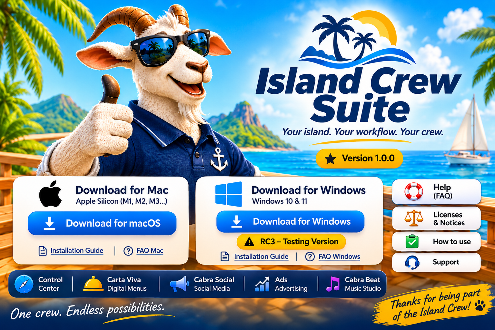
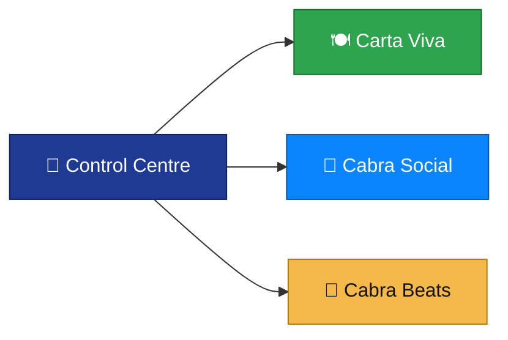

<p align="right"><a href="README.md">🇪🇸 Español</a> &nbsp;|&nbsp; <b>🇬🇧 English</b></p>

<p align="center">
  
</p>

<h1 align="center">ISLAND CREW SUITE</h1>

<p align="center"><b>Your island. Your workflow. Your crew.</b></p>

<p align="center">
Your control centre for menus, posts, ads and AI music. All in one place, on your own computer.
</p>

<p align="center">
  <a href="https://github.com/MAXIMILIANOGROSS/island-crew-downloads/releases/download/island-crew-suite-v1.1.0-macos-arm64/IslandCrewSuite-1.1.0-macos-arm64.zip"></a>
  &nbsp;
  <a href="https://github.com/MAXIMILIANOGROSS/island-crew-downloads/releases/download/island-crew-suite-v1.0.0-rc3-windows-x64/IslandCrewSuite-Setup-1.0.0-RC3-win-x64.exe"></a>
</p>

<p align="center">
  
  
  
  
  
  
  
</p>

<p align="center">
  <a href="#download"><b>Download</b></a> ·
  <a href="#start-in-3-steps">3 steps</a> ·
  <a href="#what-is-included">What is included</a> ·
  <a href="docs/CABRA-BEATS.md">Cabra Beats</a> ·
  <a href="docs/FAQ.md">FAQ</a> ·
  <a href="docs/SOPORTE.md">Support</a> ·
  <a href="https://github.com/MAXIMILIANOGROSS/island-crew-downloads/releases">Releases</a>
</p>

---

## Download

<table>
<tr>
<td width="50%" align="center" valign="top">

### 🍎 macOS

**Version 1.1.0** · includes Cabra Beats<br>
Mac with Apple silicon (M1 or later)

**[⬇️ Download the ZIP · 71,7 MB](https://github.com/MAXIMILIANOGROSS/island-crew-downloads/releases/download/island-crew-suite-v1.1.0-macos-arm64/IslandCrewSuite-1.1.0-macos-arm64.zip)**

<sub>Guide: [installation](docs/INSTALACION.md) · [FAQ](docs/FAQ.md)</sub>

</td>
<td width="50%" align="center" valign="top">

### 🪟 Windows

**Version 1.0.0-RC3** · in testing, no Cabra Beats<br>
Windows 10/11 (64 bits)

**[⬇️ Download the EXE · 28,4 MB](https://github.com/MAXIMILIANOGROSS/island-crew-downloads/releases/download/island-crew-suite-v1.0.0-rc3-windows-x64/IslandCrewSuite-Setup-1.0.0-RC3-win-x64.exe)**

<sub>Guide: [installation](docs/README-INSTALACION-WINDOWS.md) · [FAQ](docs/FAQ-WINDOWS.md)</sub>

</td>
</tr>
</table>

> [!WARNING]
> **Honest status of 1.1.0 (pre-release).** The Mac suite was installed, upgraded (1.0.0 → 1.1.0) and uninstalled successfully in isolated tests. For **Cabra Beats**, the engine installation was tested on a clean Mac, but **end-to-end music generation is not confirmed yet**. **Windows RC3** has not been validated on a real Windows computer.

> [!NOTE]
> **New in 1.1.0:** Cabra Beats (AI music) now ships inside the Mac suite. All versions: [Releases](https://github.com/MAXIMILIANOGROSS/island-crew-downloads/releases).

---

## Start in 3 steps

| 1️⃣ | 2️⃣ | 3️⃣ |
|:---:|:---:|:---:|
| **Download**<br>the ZIP (Mac) or the EXE (Windows) | **Open the installer**<br>Mac: right-click `Instalar-Mac.command` → Open | **Paste the free licence**<br>in step 3 of the wizard |

> [!TIP]
> On Mac, the installer finally offers to download the Cabra Beats engines (about 20 GB). You can do it later. More detail below, under “Installation”.

---

## What is included



| | Program | What it is for |
|:---:|---|---|
| 🧭 | **Control Centre** | Launcher and dashboard from which you open and monitor the other programs. |
| 🍽️ | **Carta Viva** | Interactive digital menus with one video per dish and a QR code. |
| 📣 | **Cabra Social** | Posts, content calendar and ads. |
| 🎵 | **Cabra Beats** | AI music: songs and jingles, covers, lyric videos and YouTube upload preparation. **Included in the Mac 1.1.0 version.** |

---

<p align="center">
  <b>🆓 Free</b> &nbsp;·&nbsp; <b>🚫 No sign-up</b> &nbsp;·&nbsp; <b>🔒 No telemetry</b> &nbsp;·&nbsp; <b>💻 Your data stays on your computer</b>
</p>


<details>
<summary><h2>Installation</h2></summary>

### 🍎 macOS

1. Download the ZIP and (optionally) check its SHA-256.
2. Double-click to unzip it.
3. Right-click (or Control-click) `Instalar-Mac.command` → **Open** → **Open**. macOS warns because the program is not yet signed with a paid Apple certificate.
4. Follow the wizard and paste the free licence in step 3.
5. At the end the installer asks whether to **download the Cabra Beats engines now**. You can do it later with `Instalar-Motores-Cabra-Beats.command`.

### 🪟 Windows (RC3, in testing)

1. Download the installer and check its SHA-256.
2. Double-click it. If Windows warns about an unrecognised app, it is because it is unsigned; run it only if the hash matches and you downloaded it from this repository.
3. It installs for your user, without administrator rights. If Visual C++ Redistributable is missing, the installer tells you.

</details>

<details>
<summary><h2>🎵 Cabra Beats</h2></summary>

- Apple silicon Mac, **16 GB of memory** and **30 GB free** on an APFS or "Mac OS Extended" disk (not exFAT/FAT/NTFS).
- The music and voice engines (about 20 GB) are **downloaded from their official websites**; they are not inside the ZIP.
- Without the engines the rest of the suite works the same; Cabra Beats cannot generate music.
- Cloned voice (RVC) is not included. Not available for Windows yet.
- Full guide: [docs/CABRA-BEATS.md](docs/CABRA-BEATS.md) (Spanish).

</details>

<details>
<summary><h2>Status by platform</h2></summary>

| Platform | Version | Status |
|---|---|---|
| macOS Apple Silicon | 1.1.0 (pre-release) | Install, upgrade from 1.0.0 and uninstall tested in isolated accounts (macOS 26.4.1, Mac mini M4). Cabra Beats: engine installation tested; end-to-end music generation not confirmed. |
| Windows x64 | 1.0.0-RC3 | Release candidate in testing. Pending validation on real Windows. |

</details>

<details>
<summary><h2>Check your download (SHA-256)</h2></summary>

```
macOS 1.1.0   c6406506cb95f40ab78bd6092c334c1dadf094d0a22897ddf3b7c86a7339502a
Windows RC3   6eccc2decd5dc41fdc57805f102a4f37aa0fde71e22d7ab7814c0a40ea94da24
```

How to check: [Verify integrity](docs/VERIFICAR-INTEGRIDAD.md) (Spanish).

</details>

<details>
<summary><h2>Previous versions</h2></summary>

| Version | Note | SHA-256 |
|---|---|---|
| [macOS 1.0.0](https://github.com/MAXIMILIANOGROSS/island-crew-downloads/releases/download/island-crew-suite-v1.0.0-macos-arm64/IslandCrewSuite-1.0.0-macos-arm64.zip) | Without Cabra Beats. Superseded by 1.1.0. | `b9d6f1ed80d4bdfc…` |
| [Cabra Beats 1.0.0 (separate)](https://github.com/MAXIMILIANOGROSS/island-crew-downloads/releases/download/island-crew-cabra-beats-v1.0.0-macos-arm64/IslandCrewSuite-CabraBeats-1.0.0-macos-arm64.zip) | No longer needed: 1.1.0 includes it. | `36203aec3baa211f…` |

</details>

<details>
<summary><h2>Documentation</h2></summary>

| Topic | Mac | Windows |
|---|---|---|
| Installation | [Guide](docs/INSTALACION.md) · [Cabra Beats](docs/CABRA-BEATS.md) | [Guide](docs/README-INSTALACION-WINDOWS.md) · [User guide](docs/GUIA-USUARIO-WINDOWS.md) |
| FAQ | [FAQ](docs/FAQ.md) | [FAQ](docs/FAQ-WINDOWS.md) |
| What is new | [1.1.0](v1.1.0/RELEASE-NOTES.md) | [RC3](v1.0.0-rc3-windows/RELEASE-NOTES.md) |

For both platforms: [Requirements](docs/REQUISITOS-Y-COMPATIBILIDAD.md) · [Backups](docs/COPIAS-DE-SEGURIDAD.md) · [Updating](docs/ACTUALIZACION.md) · [Uninstalling](docs/DESINSTALACION.md) · [Known limitations](docs/LIMITACIONES-CONOCIDAS.md) · [Privacy](docs/PRIVACIDAD.md) · [Licences and notices](docs/LICENCIAS-Y-AVISOS.md)

</details>

<details>
<summary><h2>Need help?</h2></summary>

Check the documentation and FAQ first. If you are still stuck, write to **hola@islandcrew.es** with your system and what happened.

</details>

<p align="center">
  Software by Maximiliano Olmos Sánchez for Island Crew Marketing. All rights reserved; free use is granted through the free licence.<br>
  <a href="README.md"><i>Leer esta página en español</i></a>
</p>
