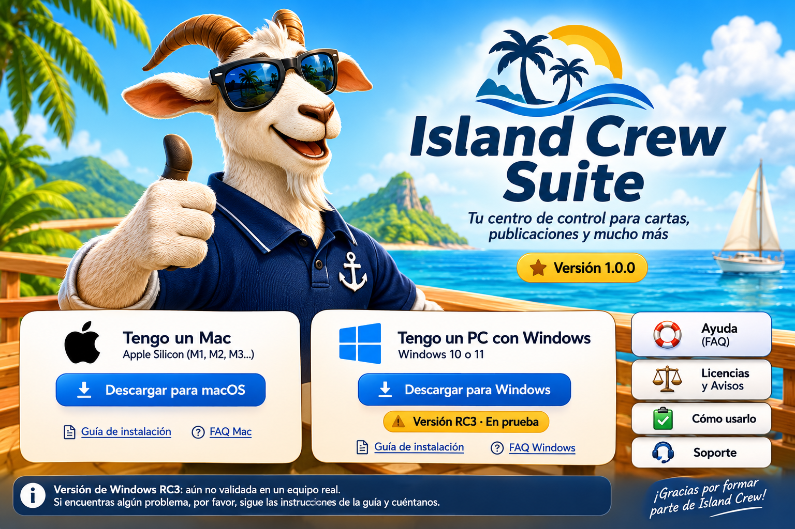

<p align="right"><b>🇪🇸 Español</b> &nbsp;|&nbsp; <a href="README.en.md">🇬🇧 English</a></p>

<p align="center">
  
</p>

<h1 align="center">ISLAND CREW SUITE</h1>

<p align="center"><b>Your island. Your workflow. Your crew.</b></p>

<p align="center">
Tu centro de control para cartas, publicaciones, anuncios y herramientas de gestión. Todo en un solo lugar.
</p>

<p align="center">
  <b>Versión 1.0.0</b> &nbsp;·&nbsp; 🍎 macOS Apple Silicon &nbsp;·&nbsp; 🪟 Windows 10/11 (RC3, en prueba) &nbsp;·&nbsp; Gratuito
</p>

<p align="center">
  <a href="https://github.com/MAXIMILIANOGROSS/island-crew-downloads/releases"><b>Ver todas las descargas (Releases)</b></a>
</p>

---

## Bienvenido a Island Crew Suite

Island Crew Suite reúne varias herramientas de trabajo para negocios de hostelería y pequeños comercios en una suite que se instala y funciona en tu propio ordenador. Está pensada para centralizar tareas del día a día: cartas digitales, publicaciones y anuncios, todo desde un panel de control.

Es gratuita: sin pagos, sin suscripciones, sin registro obligatorio y sin publicidad dentro del programa. Funciona en tu ordenador y no envía tus datos a Island Crew.

---

## Qué incluye

| | Programa | Para qué sirve |
|---|---|---|
| 🧭 | **Centro de Control** | Lanzador y panel desde el que abres y vigilas los demás programas. |
| 🍽️ | **Carta Viva** | Cartas digitales interactivas con un vídeo por plato y código QR. |
| 📣 | **Cabra Social** | Publicaciones, calendario de contenido y anuncios (pantallas *Publicaciones* y *Anuncios*). |

> **Cabra Beats** (producción musical) **no está incluido** en esta descarga. Es un producto independiente que todavía no está disponible.

---

## Descargas

<table>
<tr>
<td width="50%" valign="top">

### 🍎 macOS

**Island Crew Suite 1.0.0** · versión estable

- Mac con chip Apple (M1 o posterior).
- No funciona en Mac con procesador Intel.
- Paquete ZIP oficial (unos 71 MB).

**[⬇️ DESCARGAR PARA macOS](https://github.com/MAXIMILIANOGROSS/island-crew-downloads/releases/download/island-crew-suite-v1.0.0-macos-arm64/IslandCrewSuite-1.0.0-macos-arm64.zip)**

[Guía de instalación](docs/INSTALACION.md) · [FAQ](docs/FAQ.md) · [Licencia](LICENSE)

</td>
<td width="50%" valign="top">

### 🪟 Windows

**Island Crew Suite 1.0.0 RC3** · versión candidata

- Windows 10 y 11, 64 bits.
- Instalador x64 (unos 28 MB), sin firmar.
- Requiere Microsoft Visual C++ Redistributable 2015-2022 (x64).

**[⬇️ DESCARGAR PARA WINDOWS (RC3, EN PRUEBA)](https://github.com/MAXIMILIANOGROSS/island-crew-downloads/releases/download/island-crew-suite-v1.0.0-rc3-windows-x64/IslandCrewSuite-Setup-1.0.0-RC3-win-x64.exe)**

[Guía de instalación](docs/README-INSTALACION-WINDOWS.md) · [FAQ](docs/FAQ-WINDOWS.md) · [Hoja de pruebas](docs/HOJA-RAPIDA-PRUEBA-WINDOWS.md)

</td>
</tr>
</table>

> ⚠️ **Windows RC3 es una versión de prueba.** Todavía no se ha validado en un ordenador Windows real: se construyó y revisó solo desde macOS. Al no estar firmado, Windows puede mostrar un aviso de SmartScreen. Léete antes el [estado de validación](docs/ESTADO-VALIDACION-WINDOWS-RC3.md).

### Estado por plataforma

| Plataforma | Versión | Estado |
|---|---|---|
| macOS Apple Silicon | 1.0.0 | Release estable. Probado en macOS 26.4.1. Integridad del paquete verificada con SHA-256. |
| Windows x64 | 1.0.0-RC3 | Candidata en pruebas. Pendiente de validación en Windows real. |

### Comprueba tu descarga (SHA-256)

```
macOS    b9d6f1ed80d4bdfcff5b07a534ced0ff0e13abd2270f1dc55b24820f0eb4a5c3
Windows  6eccc2decd5dc41fdc57805f102a4f37aa0fde71e22d7ab7814c0a40ea94da24
```

Cómo comprobarlo: [Verificar integridad](docs/VERIFICAR-INTEGRIDAD.md).

---

## Instalación

**Mac**

1. Descarga el ZIP y comprueba su SHA-256.
2. Haz doble clic para descomprimirlo.
3. Clic derecho (o Control + clic) sobre `Instalar-Mac.command` → **Abrir** → **Abrir**. macOS avisa porque el programa aún no lleva firma de desarrollador de pago.
4. Sigue el asistente.

**Windows (RC3, en prueba)**

1. Descarga el instalador y comprueba su SHA-256.
2. Haz doble clic. Si Windows muestra un aviso de aplicación no reconocida, es porque el instalador no está firmado; ejecútalo solo si el hash coincide y lo has descargado de este repositorio.
3. Sigue el asistente (se instala para tu usuario, sin permisos de administrador). Si falta el Visual C++ Redistributable, el instalador te avisa.
4. Abre «Island Crew Suite» desde el Escritorio o el menú Inicio.
5. Si algo falla, cuéntalo siguiendo la [hoja de pruebas](docs/HOJA-RAPIDA-PRUEBA-WINDOWS.md).

---

## Documentación

| Tema | Mac | Windows |
|---|---|---|
| Instalación | [Guía](docs/INSTALACION.md) | [Guía](docs/README-INSTALACION-WINDOWS.md) · [Guía de usuario](docs/GUIA-USUARIO-WINDOWS.md) |
| Preguntas frecuentes | [FAQ](docs/FAQ.md) | [FAQ](docs/FAQ-WINDOWS.md) |
| Pruebas | | [Hoja rápida](docs/HOJA-RAPIDA-PRUEBA-WINDOWS.md) · [Hoja de registro](docs/HOJA_DE_REGISTRO_PRUEBAS_WINDOWS_RC3.md) |

Para ambas plataformas: [Requisitos y compatibilidad](docs/REQUISITOS-Y-COMPATIBILIDAD.md) · [Copias de seguridad](docs/COPIAS-DE-SEGURIDAD.md) · [Actualización](docs/ACTUALIZACION.md) · [Desinstalación](docs/DESINSTALACION.md) · [Limitaciones conocidas](docs/LIMITACIONES-CONOCIDAS.md) · [Privacidad](docs/PRIVACIDAD.md) · [Licencias y avisos](docs/LICENCIAS-Y-AVISOS.md)

---

## ¿Necesitas ayuda?

Consulta primero la documentación y las preguntas frecuentes. Si sigues con el problema, escríbenos a **hola@islandcrew.es** indicando tu sistema (Mac o Windows) y qué ha pasado. Más información en [Soporte](docs/SOPORTE.md).

---

<p align="center">
  Software de Maximiliano Olmos Sánchez para Island Crew Marketing. Todos los derechos reservados; el uso gratuito se concede mediante la licencia libre. <br>
  <a href="README.en.md"><i>Read this page in English</i></a>
</p>
