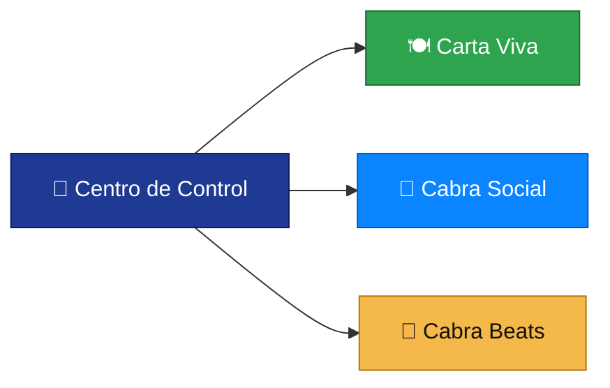

<p align="right"><b>🇪🇸 Español</b> &nbsp;|&nbsp; <a href="README.en.md">🇬🇧 English</a></p>

<p align="center">
  
</p>

<h1 align="center">ISLAND CREW SUITE</h1>

<p align="center"><b>Your island. Your workflow. Your crew.</b></p>

<p align="center">
Tu centro de control para cartas, publicaciones, anuncios y música con IA. Todo en un solo lugar, en tu propio ordenador.
</p>

<p align="center">
  <a href="https://github.com/MAXIMILIANOGROSS/island-crew-downloads/releases/download/island-crew-suite-v1.1.0-macos-arm64/IslandCrewSuite-1.1.0-macos-arm64.zip"></a>
  &nbsp;
  <a href="https://github.com/MAXIMILIANOGROSS/island-crew-downloads/releases/download/island-crew-suite-v1.0.0-rc3-windows-x64/IslandCrewSuite-Setup-1.0.0-RC3-win-x64.exe"></a>
</p>

<p align="center">
  
  
  
  
  
  
  
</p>

<p align="center">
  <a href="#descargar"><b>Descargar</b></a> ·
  <a href="#empieza-en-3-pasos">3 pasos</a> ·
  <a href="#qué-incluye">Qué incluye</a> ·
  <a href="docs/CABRA-BEATS.md">Cabra Beats</a> ·
  <a href="docs/FAQ.md">FAQ</a> ·
  <a href="docs/SOPORTE.md">Soporte</a> ·
  <a href="https://github.com/MAXIMILIANOGROSS/island-crew-downloads/releases">Releases</a>
</p>

---

## Descargar

<table>
<tr>
<td width="50%" align="center" valign="top">

### 🍎 macOS

**Versión 1.1.0** · incluye Cabra Beats<br>
Mac con chip Apple (M1 o posterior)

**[⬇️ Descargar el ZIP · 71,7 MB](https://github.com/MAXIMILIANOGROSS/island-crew-downloads/releases/download/island-crew-suite-v1.1.0-macos-arm64/IslandCrewSuite-1.1.0-macos-arm64.zip)**

<sub>Guía: [instalación](docs/INSTALACION.md) · [FAQ](docs/FAQ.md)</sub>

</td>
<td width="50%" align="center" valign="top">

### 🪟 Windows

**Versión 1.0.0-RC3** · en prueba, sin Cabra Beats<br>
Windows 10/11 (64 bits)

**[⬇️ Descargar el EXE · 28,4 MB](https://github.com/MAXIMILIANOGROSS/island-crew-downloads/releases/download/island-crew-suite-v1.0.0-rc3-windows-x64/IslandCrewSuite-Setup-1.0.0-RC3-win-x64.exe)**

<sub>Guía: [instalación](docs/README-INSTALACION-WINDOWS.md) · [FAQ](docs/FAQ-WINDOWS.md)</sub>

</td>
</tr>
</table>

> [!WARNING]
> **Estado honesto de la 1.1.0 (pre-release).** La suite de Mac se instaló, se actualizó (1.0.0 → 1.1.0) y se desinstaló con éxito en pruebas aisladas. En **Cabra Beats**, la instalación de los motores se probó en un Mac limpio, pero la **generación de música de principio a fin aún no está confirmada**. **Windows RC3** no se ha validado en un ordenador Windows real.

> [!NOTE]
> **Novedad 1.1.0:** Cabra Beats (música con IA) viene ya dentro de la suite de Mac. Todas las versiones: [Releases](https://github.com/MAXIMILIANOGROSS/island-crew-downloads/releases).

---

## Empieza en 3 pasos

| 1️⃣ | 2️⃣ | 3️⃣ |
|:---:|:---:|:---:|
| **Descarga**<br>el ZIP (Mac) o el EXE (Windows) | **Abre el instalador**<br>Mac: clic derecho en `Instalar-Mac.command` → Abrir | **Pega la licencia libre**<br>en el paso 3 del asistente |

> [!TIP]
> En Mac, al final el instalador te ofrece descargar los motores de Cabra Beats (unos 20 GB). Puedes dejarlo para después. Más detalle abajo, en «Instalación».

---

## Qué incluye



| | Programa | Para qué sirve |
|:---:|---|---|
| 🧭 | **Centro de Control** | Lanzador y panel desde el que abres y vigilas los demás programas. |
| 🍽️ | **Carta Viva** | Cartas digitales interactivas con un vídeo por plato y código QR. |
| 📣 | **Cabra Social** | Publicaciones, calendario de contenido y anuncios. |
| 🎵 | **Cabra Beats** | Música con IA: canciones y jingles, portadas, vídeos con la letra y preparación de la subida a YouTube. **Incluida en la versión de Mac 1.1.0.** |

---

<p align="center">
  <b>🆓 Gratis</b> &nbsp;·&nbsp; <b>🚫 Sin registro</b> &nbsp;·&nbsp; <b>🔒 Sin telemetría</b> &nbsp;·&nbsp; <b>💻 Tus datos no salen de tu ordenador</b>
</p>


<details>
<summary><h2>Instalación</h2></summary>

### 🍎 macOS

1. Descarga el ZIP y (opcional) comprueba su SHA-256.
2. Haz doble clic para descomprimirlo.
3. Clic derecho (o Control + clic) sobre `Instalar-Mac.command` → **Abrir** → **Abrir**. macOS avisa porque el programa aún no lleva firma de pago de Apple.
4. Sigue el asistente y pega la licencia libre en el paso 3.
5. Al final, el instalador te pregunta si quieres **descargar ahora los motores de Cabra Beats**. Puedes dejarlo para más tarde con `Instalar-Motores-Cabra-Beats.command`.

### 🪟 Windows (RC3, en prueba)

1. Descarga el instalador y comprueba su SHA-256.
2. Haz doble clic. Si Windows avisa de aplicación no reconocida es porque no está firmado; ejecútalo solo si el hash coincide y lo has descargado de este repositorio.
3. Se instala para tu usuario, sin permisos de administrador. Si falta Visual C++ Redistributable, el instalador te avisa.

</details>

<details>
<summary><h2>🎵 Cabra Beats</h2></summary>

- Mac con chip Apple, **16 GB de memoria** y **30 GB libres** en un disco APFS o «Mac OS Plus» (no exFAT/FAT/NTFS).
- Los motores de música y voz (unos 20 GB) se **descargan de sus webs oficiales**; no van dentro del ZIP.
- Sin los motores, el resto de la suite funciona igual; Cabra Beats no puede generar música.
- No incluye la voz clonada (RVC). Todavía no existe para Windows.
- Guía completa: [docs/CABRA-BEATS.md](docs/CABRA-BEATS.md).

</details>

<details>
<summary><h2>Estado por plataforma</h2></summary>

| Plataforma | Versión | Estado |
|---|---|---|
| macOS Apple Silicon | 1.1.0 (pre-release) | Instalación, actualización desde 1.0.0 y desinstalación probadas en cuentas aisladas (macOS 26.4.1, Mac mini M4). Cabra Beats: instalación de motores probada; generación de música de principio a fin sin confirmar. |
| Windows x64 | 1.0.0-RC3 | Candidata en pruebas. Pendiente de validar en Windows real. |

</details>

<details>
<summary><h2>Comprueba tu descarga (SHA-256)</h2></summary>

```
macOS 1.1.0   c6406506cb95f40ab78bd6092c334c1dadf094d0a22897ddf3b7c86a7339502a
Windows RC3   6eccc2decd5dc41fdc57805f102a4f37aa0fde71e22d7ab7814c0a40ea94da24
```

Cómo comprobarlo: [Verificar integridad](docs/VERIFICAR-INTEGRIDAD.md).

</details>

<details>
<summary><h2>Versiones anteriores</h2></summary>

| Versión | Nota | SHA-256 |
|---|---|---|
| [macOS 1.0.0](https://github.com/MAXIMILIANOGROSS/island-crew-downloads/releases/download/island-crew-suite-v1.0.0-macos-arm64/IslandCrewSuite-1.0.0-macos-arm64.zip) | Sin Cabra Beats. Sustituida por la 1.1.0. | `b9d6f1ed80d4bdfc…` |
| [Cabra Beats 1.0.0 (aparte)](https://github.com/MAXIMILIANOGROSS/island-crew-downloads/releases/download/island-crew-cabra-beats-v1.0.0-macos-arm64/IslandCrewSuite-CabraBeats-1.0.0-macos-arm64.zip) | Ya no hace falta: la 1.1.0 la incluye. | `36203aec3baa211f…` |

</details>

<details>
<summary><h2>Documentación</h2></summary>

| Tema | Mac | Windows |
|---|---|---|
| Instalación | [Guía](docs/INSTALACION.md) · [Cabra Beats](docs/CABRA-BEATS.md) | [Guía](docs/README-INSTALACION-WINDOWS.md) · [Guía de usuario](docs/GUIA-USUARIO-WINDOWS.md) |
| FAQ | [FAQ](docs/FAQ.md) | [FAQ](docs/FAQ-WINDOWS.md) |
| Novedades | [1.1.0](v1.1.0/RELEASE-NOTES.md) | [RC3](v1.0.0-rc3-windows/RELEASE-NOTES.md) |

Para ambas plataformas: [Requisitos](docs/REQUISITOS-Y-COMPATIBILIDAD.md) · [Copias de seguridad](docs/COPIAS-DE-SEGURIDAD.md) · [Actualización](docs/ACTUALIZACION.md) · [Desinstalación](docs/DESINSTALACION.md) · [Limitaciones conocidas](docs/LIMITACIONES-CONOCIDAS.md) · [Privacidad](docs/PRIVACIDAD.md) · [Licencias y avisos](docs/LICENCIAS-Y-AVISOS.md)

</details>

<details>
<summary><h2>¿Necesitas ayuda?</h2></summary>

Consulta primero la documentación y las preguntas frecuentes. Si sigues con el problema, escribe a **hola@islandcrew.es** indicando tu sistema y qué ha pasado.

</details>

<p align="center">
  Software de Maximiliano Olmos Sánchez para Island Crew Marketing. Todos los derechos reservados; el uso gratuito se concede mediante la licencia libre.<br>
  <a href="README.en.md"><i>Read this page in English</i></a>
</p>
